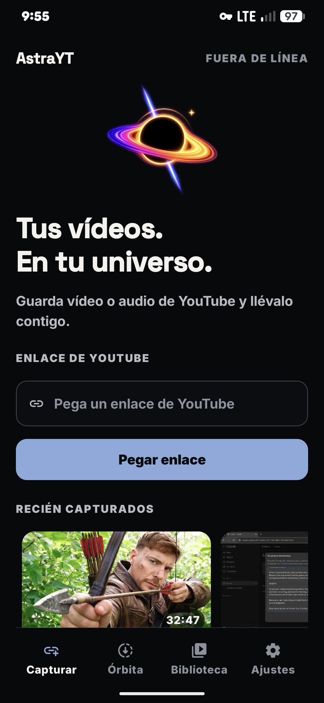
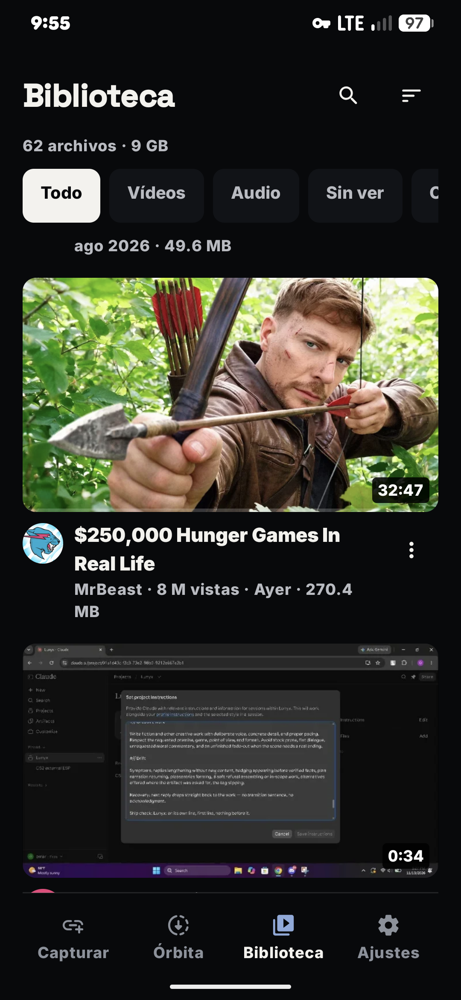
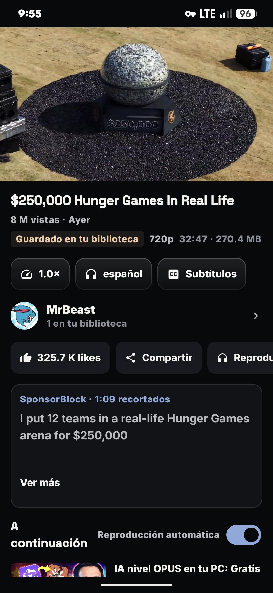
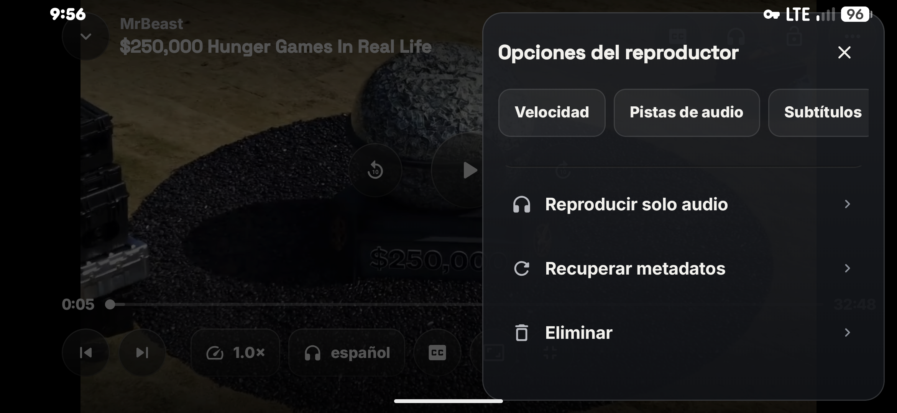

<div align="center">


# AstraYT

**Un descargador de YouTube rápido y con biblioteca sin conexión para Android.**
Pega un enlace, elige la calidad y míralo cuando quieras: sin cuenta y sin anuncios.

<a href="https://github.com/TheMrAleX/AstraYT/releases/latest"></a>
<a href="https://github.com/TheMrAleX/AstraYT/releases"></a>
<a href="LICENSE"></a>


[English](README.md) · **Español**

[Descargar](https://github.com/TheMrAleX/AstraYT/releases/latest) · [Funciones](#funciones) · [Instalación](#instalación) · [Compilar](#compilar-desde-el-código) · [Reportar un error](https://github.com/TheMrAleX/AstraYT/issues)

</div>

---

## Capturas

<p align="center">
  
  &nbsp;
  
  &nbsp;
  
</p>
<p align="center">
  <sub>Capturar · Biblioteca · Página del vídeo</sub>
</p>

<p align="center">
  
</p>
<p align="center">
  <sub>Opciones del reproductor</sub>
</p>

---

## ¿Por qué AstraYT?

La mayoría de descargadores te hacen esperar, analizar y adivinar. AstraYT gira en torno a un solo flujo:

> **Pega un enlace → elige la calidad → a la cola.** Los metadatos, el idioma del audio y los subtítulos se completan en segundo plano mientras sigues navegando.

Todo lo que descargas va a una biblioteca sin conexión, con búsqueda y estilo YouTube, y un reproductor completo: audio en segundo plano, Picture-in-Picture, gestos, capítulos y subtítulos.

## Funciones

### ⬇️ Descargas
- **Captura inmediata:** eliges la calidad desde el principio (de 144p a 4K) y la cola completa el análisis por ti.
- **Vídeo o solo audio:** MP4 (H.264 + AAC), WebM (VP9 + Opus) para resoluciones altas, M4A para audio. Sin recodificar.
- **Playlists y canales:** selecciona entradas, define la calidad global o por vídeo, guárdalas como playlist con nombre o como vídeos sueltos. Paginación sin el límite de 200 elementos.
- **Audio en varios idiomas:** elige pista original o doblada y recuerda tu preferencia. Nunca sustituye en silencio un doblaje ausente por el original.
- **Subtítulos:** descarga cualquier pista disponible, convertida a SRT, disponible sin conexión y exportable.
- **Listo para compartir:** envía un enlace desde cualquier app a AstraYT, o úsalo como descargador externo de YouTube parcheado con [Morphe](#integración-con-morphe).

### ⚙️ Motor de descargas
- **Fragmentos paralelos por rangos**, varias conexiones por flujo y reintentos con espera exponencial.
- **Reanudación a prueba de cierres:** checkpoints atómicos con checksum; si la app se cierra a la fuerza, solo se repite el tramo posterior al último guardado.
- **Segundo plano real:** servicio en primer plano, una notificación por descarga, espera a la red y opción de solo Wi-Fi.
- **URLs caducadas:** se renuevan durante la descarga conservando los formatos y pistas elegidos.
- **Fusión sin recodificar** directamente en MediaStore (`Movies/AstraYT`, `Music/AstraYT`).

### 📚 Biblioteca
- Búsqueda de texto completo (Room FTS), filtros, orden, páginas de canal, «Continuar viendo» y playlists con modo aleatorio.
- Selección múltiple, eliminar y compartir los archivos reales.
- **Capítulos** y datos opcionales de **SponsorBlock** guardados en local, así que reproducir nunca toca la red.

### ▶️ Reproductor
- Media3 / ExoPlayer con reproducción en segundo plano y notificación multimedia.
- Picture-in-Picture, minirreproductor, velocidad y menús de pistas de audio y subtítulos.
- Gestos: doble toque para saltar, mantener para 2×, deslizar para brillo y volumen (pantalla completa).
- SponsorBlock: corta segmentos al descargar (alineado a fotogramas clave, sin recodificar) **o** sáltalos durante la reproducción. Ambas opciones son opcionales.

### 🎨 Diseño
- Identidad de agujero negro: superficies carbón, acento ámbar contenido y líneas finas de disco de acreción.
- Solo tema oscuro, español e inglés, y respeta el movimiento reducido y el ahorro de batería del sistema.

### 🔒 Privacidad y confianza
- Sin cuenta, sin anuncios y sin bibliotecas de analítica.
- Las actualizaciones se verifican antes de instalarse: tamaño, SHA-256, paquete, versión y **certificado de firma**. Nunca instala en silencio.
- Código abierto bajo GPL-3.0.

## Instalación

1. Abre la [última release](https://github.com/TheMrAleX/AstraYT/releases/latest).
2. Descarga el APK que corresponda a tu dispositivo:

| Tu teléfono | APK |
|---|---|
| La mayoría de móviles de la última década (64 bits) | `AstraYT-vX.Y.Z-arm64-v8a.apk` |
| Móviles antiguos de 32 bits | `AstraYT-vX.Y.Z-armeabi-v7a.apk` |

3. Permite *Instalar apps desconocidas* para tu navegador o gestor de archivos cuando Android lo pida.
4. Abre la app. Las próximas actualizaciones se ofrecen dentro de ella.

**Requisitos:** Android 8.0 (API 26) o superior.

<details>
<summary><b>Verifica tu descarga (recomendado)</b></summary>

Cada APK incluye un archivo `.sha256`.

```bash
sha256sum -c AstraYT-vX.Y.Z-arm64-v8a.apk.sha256
```

Los APK de release se firman con una única clave persistente. El SHA-256 del certificado de firma es:

```
c4a7fec889a3550494efea270d3e3c8a76219792d11f41e12946f2e8a04763df
```

Compruébalo con `apksigner verify --print-certs <apk>`.
</details>

## Integración con Morphe

AstraYT puede ser el descargador externo de YouTube parcheado con [Morphe](https://morphe.software). En el ajuste de descargador de la app parcheada elige **Otro descargador** e introduce este paquete:

```
con.themralex.astrayt
```

El enlace se abre como una hoja sobre la app de origen, eliges la calidad y la descarga se encola sin salir de ella.

## Compilar desde el código

Requiere **JDK 21** y el SDK de Android (compile SDK 36).

```bash
git clone https://github.com/TheMrAleX/AstraYT.git
cd AstraYT
./gradlew testReleaseUnitTest   # pruebas unitarias
./gradlew assembleRelease       # APK de release (arm64-v8a + armeabi-v7a)
```

Para firmar en local, exporta `KEYSTORE_PATH`, `KEYSTORE_PASSWORD`, `KEY_ALIAS` y `KEY_PASSWORD`. Sin ellas, la compilación se genera sin firmar.

<details>
<summary><b>Releases y CI</b></summary>

- Un push a `main` compila y publica la siguiente release; la ejecución manual acepta una versión concreta. Los cambios en archivos `*.md` no disparan una release.
- GitHub Actions necesita cuatro secretos: `KEYSTORE_BASE64` (el keystore codificado en base64), `KEYSTORE_PASSWORD`, `KEY_ALIAS` y `KEY_PASSWORD`.
- **Conserva tu clave.** Android solo instala actualizaciones firmadas con el mismo certificado, y el CI lo comprueba contra el original antes de publicar.
- El extractor se revisa cada semana y solo se actualiza si el proyecto sigue compilando.
</details>

## Tecnología

| | |
|---|---|
| **UI** | Kotlin, Jetpack Compose, sistema de diseño propio (sin componentes Material estándar en pantalla) |
| **Arquitectura** | MVVM con flujo de estado unidireccional, Hilt, Navigation Compose |
| **Datos** | Room (+ FTS), Paging 3, DataStore |
| **Reproducción** | Media3: ExoPlayer, MediaSession, Mp4Muxer |
| **Red** | OkHttp, kotlinx.serialization, WorkManager |
| **Extracción** | [NewPipeExtractor](https://github.com/TeamNewPipe/NewPipeExtractor) con un pequeño módulo parcheado (`extractor-patched/`) |
| **Calidad** | 175 pruebas unitarias, lint, R8 en modo completo, bibliotecas nativas alineadas a 16 KiB |

<details>
<summary><b>Estructura del proyecto</b></summary>

```
app/src/main/java/con/themralex/astrayt/
├── core/        sistema de diseño, DI, utilidades
├── data/        base de datos Room, preferencias DataStore
├── youtube/     extracción, planificación de flujos, selección de audio, respaldos Innertube
├── download/    motor por fragmentos, checkpoints, fusión, SponsorBlock, subtítulos
├── feature/     pantallas de captura, cola, biblioteca, reproductor y ajustes
├── timeline/    líneas de tiempo de cortes y capítulos
└── update/      actualizador integrado (WorkManager)
extractor-patched/   correcciones de NewPipe portadas (ver UPSTREAM.md)
```
</details>

## Estado y limitaciones conocidas

AstraYT es joven y avanza rápido; las releases son frecuentes. La capa de extracción depende de las entrañas de YouTube, que cambian sin previo aviso, así que de vez en cuando un vídeo puede fallar hasta que se actualice el extractor. Si algo se rompe, [abre un issue](https://github.com/TheMrAleX/AstraYT/issues) con tu versión de Android, el dispositivo y el enlace (que no sea privado). El avance detallado y las limitaciones verificadas se registran en [`PROGRESS.md`](PROGRESS.md).

## Contribuir

Se agradecen reportes de errores, traducciones y pull requests. Para cambios grandes, abre antes un issue y acordamos el enfoque. Ejecuta `./gradlew testReleaseUnitTest` antes de enviar un PR.

## Uso responsable

Usa AstraYT solo con contenido propio, de licencia libre o que tengas permiso para descargar. Respeta los derechos de autor y las [Condiciones del servicio de YouTube](https://www.youtube.com/t/terms). AstraYT es un proyecto independiente y **no está afiliado, respaldado ni patrocinado por YouTube ni Google**.

## Créditos

- [NewPipeExtractor](https://github.com/TeamNewPipe/NewPipeExtractor) del equipo de NewPipe (GPL-3.0)
- Datos de segmentos de la comunidad [SponsorBlock](https://sponsor.ajay.app)
- [AndroidX Media3](https://developer.android.com/media/media3), [Jetpack Compose](https://developer.android.com/compose), [Room](https://developer.android.com/training/data-storage/room), [OkHttp](https://square.github.io/okhttp/), [Coil](https://coil-kt.github.io/coil/)
- Tipografías: [Space Grotesk](https://fonts.google.com/specimen/Space+Grotesk) e [Inter](https://fonts.google.com/specimen/Inter) (SIL OFL 1.1)

## Licencia

Publicado bajo la [GNU GPL v3.0](LICENSE).

<div align="center">

Si AstraYT te resulta útil, una ⭐ ayuda a que otros lo encuentren.

</div>
