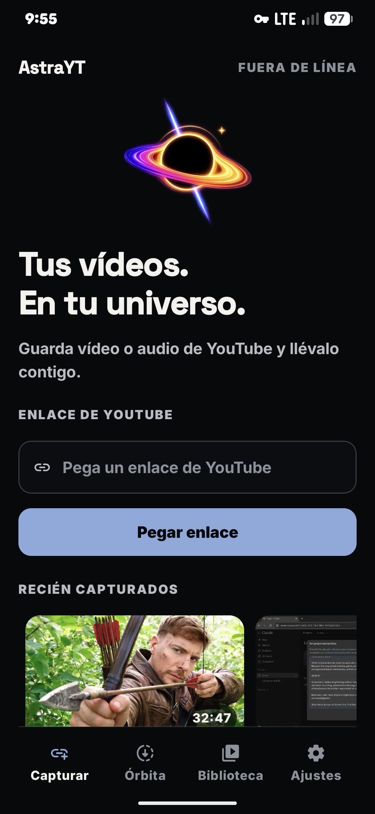
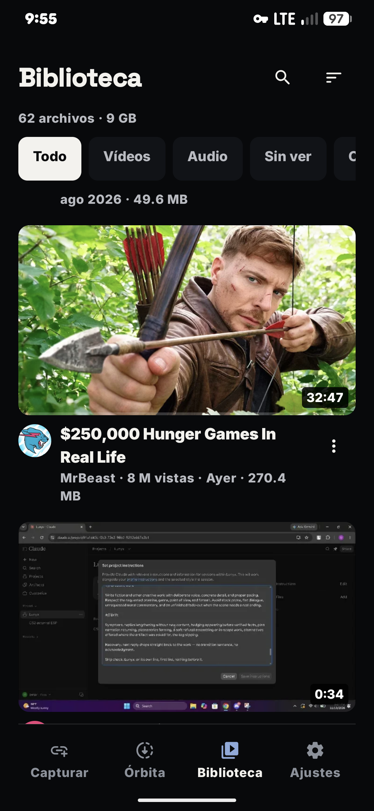
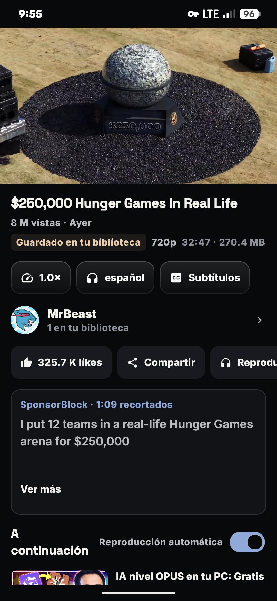
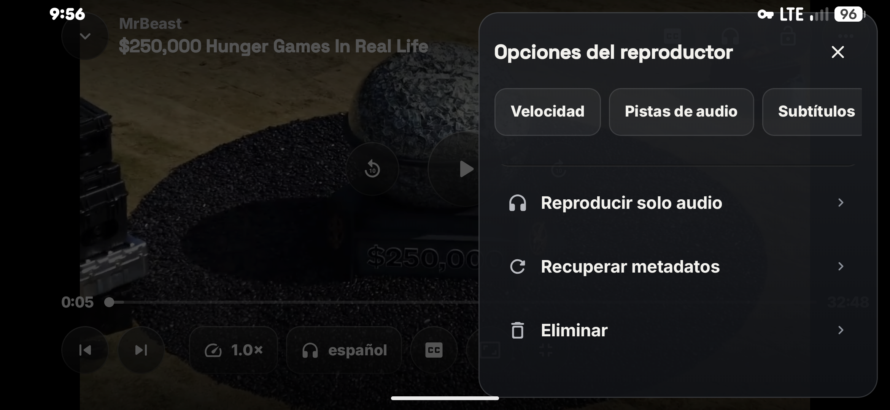

<div align="center">


# AstraYT

**A fast, offline-first YouTube downloader and library for Android.**
Paste a link, pick a quality, and watch it later: no account, no ads.

<a href="https://github.com/TheMrAleX/AstraYT/releases/latest"></a>
<a href="https://github.com/TheMrAleX/AstraYT/releases"></a>
<a href="LICENSE"></a>


**English** · [Español](README.es.md)

[Download](https://github.com/TheMrAleX/AstraYT/releases/latest) · [Features](#features) · [Install](#install) · [Build](#build-from-source) · [Report a bug](https://github.com/TheMrAleX/AstraYT/issues)

</div>

---

## Screenshots

<p align="center">
  
  &nbsp;
  
  &nbsp;
  
</p>
<p align="center">
  <sub>Capture · Library · Watch page</sub>
</p>

<p align="center">
  
</p>
<p align="center">
  <sub>Player options</sub>
</p>

---

## Why AstraYT?

Most downloaders make you wait, analyze, and guess. AstraYT is built around one flow:

> **Paste a link → choose a quality → it's queued.** Metadata, audio language and subtitles are resolved in the background while you keep browsing.

Everything you download lands in a searchable, YouTube-style offline library with a real player: background audio, Picture-in-Picture, gestures, chapters and subtitles.

## Features

### ⬇️ Downloading
- **Instant capture:** the quality is chosen up front (144p to 4K) and the queue completes analysis for you.
- **Video or audio-only:** MP4 (H.264 + AAC), WebM (VP9 + Opus) for higher resolutions, M4A for audio. No re-encoding.
- **Playlists and channels:** select entries, set quality globally or per video, save as a named playlist or as loose videos. Pagination with no 200-item cap.
- **Multi-language audio:** pick original or dubbed tracks, with a remembered language preference. Never silently swaps a missing dub for the original.
- **Subtitles:** download any available track, converted to SRT, available offline and exportable.
- **Share-sheet ready:** send a link from any app to AstraYT, or use it as the external downloader for [Morphe](#morphe-integration)-patched YouTube.

### ⚙️ Download engine
- **Parallel ranged chunks** with multiple connections per stream and exponential backoff.
- **Crash-proof resume:** atomic checksummed checkpoints, so a force-close only repeats the segment after the last save.
- **Real background operation:** foreground service, per-download notifications, waits for network, optional Wi-Fi only.
- **Expired URLs handled:** stream URLs are refreshed mid-download while keeping the chosen formats and tracks.
- **Merge without re-encoding** straight into MediaStore (`Movies/AstraYT`, `Music/AstraYT`).

### 📚 Library
- Full-text search (Room FTS), filters, sorting, channel pages, "Continue watching", playlists with shuffle.
- Multi-select, delete, and share the actual files.
- Offline **chapters** and optional **SponsorBlock** data, stored locally so playback never touches the network.

### ▶️ Player
- Media3 / ExoPlayer with background playback and a media notification.
- Picture-in-Picture, mini-player, speed control, audio/subtitle track menus.
- Gestures: double-tap to seek, hold for 2×, swipe for brightness and volume (fullscreen).
- SponsorBlock: cut segments on download (keyframe-aligned, no re-encode) **or** skip them during playback. Both optional.

### 🎨 Design
- Black-hole identity: carbon surfaces, restrained amber accent, thin accretion-disk linework.
- Dark theme only, Spanish and English, respects system reduce-motion and battery saver.

### 🔒 Privacy and trust
- No account, no ads, no analytics libraries.
- Updates are verified before install: size, SHA-256, package name, version and **signing certificate**. Never installs silently.
- Open source under GPL-3.0.

## Install

1. Open the [latest release](https://github.com/TheMrAleX/AstraYT/releases/latest).
2. Download the APK for your device:

| Your phone | APK |
|---|---|
| Most phones from the last decade (64-bit) | `AstraYT-vX.Y.Z-arm64-v8a.apk` |
| Older 32-bit phones | `AstraYT-vX.Y.Z-armeabi-v7a.apk` |

3. Allow *Install unknown apps* for your browser or file manager when Android asks.
4. Open the app. Future updates are offered in-app.

**Requirements:** Android 8.0 (API 26) or newer.

<details>
<summary><b>Verify your download (recommended)</b></summary>

Each APK ships with a `.sha256` file.

```bash
sha256sum -c AstraYT-vX.Y.Z-arm64-v8a.apk.sha256
```

Release APKs are signed with a single persistent key. The signing certificate SHA-256 is:

```
c4a7fec889a3550494efea270d3e3c8a76219792d11f41e12946f2e8a04763df
```

Check it with `apksigner verify --print-certs <apk>`.
</details>

## Morphe integration

AstraYT can act as the external downloader for YouTube patched with [Morphe](https://morphe.software). In the patched app's downloader setting choose **Other downloader** and enter this package:

```
con.themralex.astrayt
```

The link opens as a sheet over the app you came from, you pick the quality, and the download is queued without leaving it.

## Build from source

Requires **JDK 21** and the Android SDK (compile SDK 36).

```bash
git clone https://github.com/TheMrAleX/AstraYT.git
cd AstraYT
./gradlew testReleaseUnitTest   # unit tests
./gradlew assembleRelease       # release APKs (arm64-v8a + armeabi-v7a)
```

To sign locally, export `KEYSTORE_PATH`, `KEYSTORE_PASSWORD`, `KEY_ALIAS` and `KEY_PASSWORD`. Without them the build is produced unsigned.

<details>
<summary><b>Releases and CI</b></summary>

- A push to `main` builds and publishes the next release; a manual run accepts a specific version. Changes to `*.md` files do not trigger a release.
- GitHub Actions needs four secrets: `KEYSTORE_BASE64` (the keystore, base64-encoded), `KEYSTORE_PASSWORD`, `KEY_ALIAS`, `KEY_PASSWORD`.
- **Keep your key.** Android only installs updates signed with the same certificate, and CI checks it against the original before publishing.
- The extractor is checked weekly and only bumped if the project still compiles.
</details>

## Tech stack

| | |
|---|---|
| **UI** | Kotlin, Jetpack Compose, custom design system (no stock Material components on screen) |
| **Architecture** | MVVM with unidirectional state, Hilt, Navigation Compose |
| **Data** | Room (+ FTS), Paging 3, DataStore |
| **Playback** | Media3: ExoPlayer, MediaSession, Mp4Muxer |
| **Network** | OkHttp, kotlinx.serialization, WorkManager |
| **Extraction** | [NewPipeExtractor](https://github.com/TeamNewPipe/NewPipeExtractor) with a small patched module (`extractor-patched/`) |
| **Quality** | 175 unit tests, lint, R8 full mode, 16 KiB ZIP-aligned native libs |

<details>
<summary><b>Project layout</b></summary>

```
app/src/main/java/con/themralex/astrayt/
├── core/        design system, DI, utilities
├── data/        Room database, DataStore preferences
├── youtube/     extraction, stream planning, audio track selection, Innertube fallbacks
├── download/    chunked engine, checkpoints, muxing, SponsorBlock, subtitles
├── feature/     capture, queue, library, player, settings screens
├── timeline/    cut and chapter timelines
└── update/      in-app updater (WorkManager)
extractor-patched/   backported NewPipe fixes (see UPSTREAM.md)
```
</details>

## Status and known limitations

AstraYT is young and moves fast; releases are frequent. The extraction layer depends on YouTube's internals, which change without notice, so occasionally a video may fail until the extractor is updated. If something breaks, please [open an issue](https://github.com/TheMrAleX/AstraYT/issues) with your Android version, device, and the (non-private) link. Detailed progress and verified limitations are tracked in [`PROGRESS.md`](PROGRESS.md).

## Contributing

Bug reports, translations and pull requests are welcome. For anything large, open an issue first so we can agree on the approach. Run `./gradlew testReleaseUnitTest` before sending a PR.

## Responsible use

Use AstraYT only with content that is yours, freely licensed, or that you have permission to download. Respect copyright and [YouTube's Terms of Service](https://www.youtube.com/t/terms). AstraYT is an independent project and is **not affiliated with, endorsed by, or sponsored by YouTube or Google**.

## Credits

- [NewPipeExtractor](https://github.com/TeamNewPipe/NewPipeExtractor) by the NewPipe team (GPL-3.0)
- [SponsorBlock](https://sponsor.ajay.app) community segment data
- [AndroidX Media3](https://developer.android.com/media/media3), [Jetpack Compose](https://developer.android.com/compose), [Room](https://developer.android.com/training/data-storage/room), [OkHttp](https://square.github.io/okhttp/), [Coil](https://coil-kt.github.io/coil/)
- Fonts: [Space Grotesk](https://fonts.google.com/specimen/Space+Grotesk) and [Inter](https://fonts.google.com/specimen/Inter) (SIL OFL 1.1)

## License

Released under the [GNU GPL v3.0](LICENSE).

<div align="center">

If AstraYT is useful to you, a ⭐ helps others find it.

</div>
